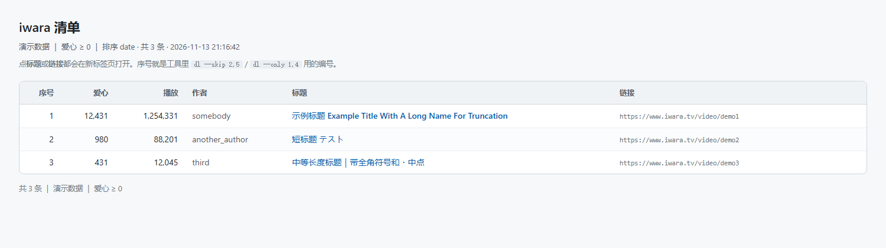
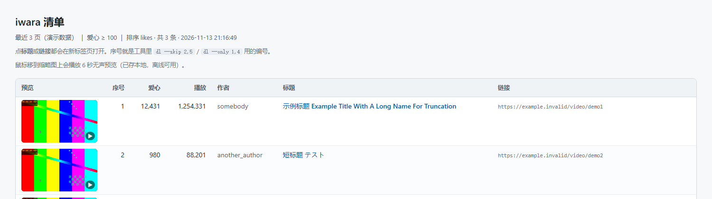
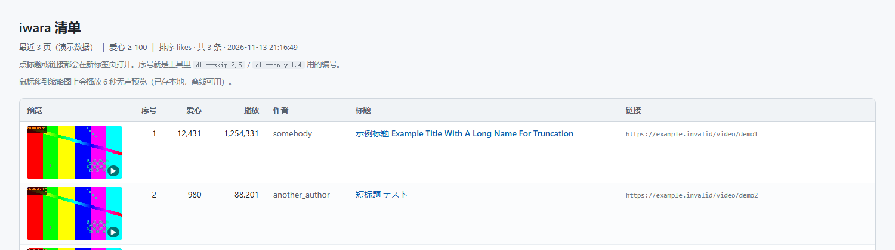

# iwara 工具集

在 Windows 上按页抓取 [iwara](https://www.iwara.tv) 视频列表、按爱心数筛选、生成**可点击链接的 HTML 清单**、批量下载，并给清单加**悬停预览**的一套小工具。

命令行入口是一个可双击的 `iwara-dl.cmd`，进去后是交互式提示符；也可以带参数直接调用。

> 仅供个人离线备份使用。请遵守站点条款与作者授权，不要二次分发下载内容。

---

## 功能

| 功能 | 说明 |
|---|---|
| **列表筛选** | 指定页数或页范围、爱心数下限、播放数下限、作者、排序方式、显示条数 |
| **终端表格** | 序号 / 爱心 / 播放 / 作者 / 标题，中日韩字符按 2 列宽对齐，表格宽度自适应窗口 |
| **HTML 清单** | 生成后自动用浏览器打开；标题与链接可点击，表头吸顶、隔行底色 |
| **批量下载** | 逐条进度、失败不中断、`archive.txt` 断点续传（重跑自动跳过已下载） |
| **按序号挑选** | `dl --skip 2,5,8-10` 跳过某几项，`dl --only 1,4` 只下某几项 |
| **体积闸门** | 小于指定体积（默认 100 MB）的视频不下载，下载前探测真实大小 |
| **悬停预览** | 清单里鼠标移到缩略图上播放 6 秒无声预览；**按整片时长均匀取 6 段**，不是开头连续 6 秒 |
| **预览自动清理** | 视频下载完成后，预览小片保留 2 小时再自动删除（可调） |

### 截图

> 下面的截图全部来自 `list --demo` 的假数据与 ffmpeg `testsrc2` 测试图案（彩条），**不含任何站内真实内容**。

HTML 清单（标题与链接可点击；真实使用时预览格是视频缩略图）：



悬停前后对比：

| 静态：海报 + ▶ 角标 | 悬停：本地 6 秒小片在播 |
|---|---|
|  |  |

示例片长 175 秒，取样点为 0 / 35 / 70 / 104 / 139 / 174 秒：


---

## 依赖

| 组件 | 版本 | 用途 |
|---|---|---|
| Windows PowerShell 5.1 | 系统自带 | 交互与批处理 |
| Python | 3.9+（本机 3.14） | 列表查询 / 体积探测 / 预览切片 |
| [yt-dlp](https://github.com/yt-dlp/yt-dlp) | 2026.10.26+ | 下载，原生支持 iwara |
| [curl_cffi](https://github.com/lexiforest/curl_cffi) | 0.17+ | 过 Cloudflare（`--impersonate chrome`） |
| [ffmpeg](https://ffmpeg.org/) | 9.x | 预览切片与转码 |

```powershell
python -m pip install --user --upgrade yt-dlp curl_cffi
winget install Gyan.FFmpeg
```

`iwara-dl.ps1` 里有三处路径常量（`yt-dlp` 目录、`ffmpeg` 目录、Python 版本号），换机器时按需改：

```powershell
$ytdlpDir   = Join-Path $env:APPDATA 'Python\Python314\Scripts'
$wingetLinks = Join-Path $env:LOCALAPPDATA 'Microsoft\WinGet\Links'
```

---

## 用法

双击 `iwara-dl.cmd`，在 `命令/链接` 提示符下输入：

### 1. 列表

```
list <页数或范围> <爱心下限> [显示条数] [选项]
```

| 示例 | 作用 |
|---|---|
| `list 3 100` | 最近 3 页，爱心 ≥ 100 |
| `list 2-5 200` | **第 2 到第 5 页**（页码从 1 起） |
| `list 2-5 200 10` | 同上，只显示前 10 条 |
| `list 3 100 --user someone` | 只看某作者 |
| `list 3 100 --sort likes` | 排序：`date` / `trending` / `popular` / `views` / `likes` |
| `list 3 100 --min-views 20000` | 再加播放量门槛 |
| `list 3 100 --links` | 终端表格里也显示完整链接列 |
| `list 3 100 --urls` | 只输出链接 |
| `list --demo` | 用假数据看表格排版，不联网 |

结果表格形如：

```
序号     爱心        播放  作者              标题
────────────────────────────────────────────────────────────────────────────
   1   12,431   1,254,331  somebody          示例标题 Example Title…
```

同时写出 `downloads\_last_list.html`（可点击清单），并自动在浏览器打开。

### 2. 下载

```
dl                     下载上一次 list 的结果
dl 我的清单.txt         指定 txt（一行一个链接，或 HTML 清单）
dl --skip 2,5,8-10     跳过这几项
dl --only 1,4          只下这几项
dl --skip 3 --only 1-6 两个规则叠加
```

也可以直接把链接粘进来（空格分隔多个），或把 txt 拖到 `iwara-dl.cmd` 上。

- 汇总会给出：`成功 x ｜ 体积跳过 y（<100MB）｜ 手动跳过 z ｜ 失败 w`
- 已下载的记录在 `downloads\archive.txt`，重跑同一清单会自动跳过

### 3. 设置

```
min 150            体积下限改为 150 MB（0 = 不过滤）
preview-keep 2     下载后预览小片保留几小时（0 = 立刻删）
preview-clean      立刻执行一次过期清理并报告数量
open               重新打开上次的 HTML 清单
help / q           帮助 / 退出
```

---

## 悬停预览是怎么做的

iwara 卡片悬停用的不是 GIF，而是每部片子额外转的一路 **preview 低码率流**（实测 **320×180 @ 1fps**）。但这个流是带 `expires` 签名的临时链接，**有效期只有 1 小时**，直接写进 HTML 一小时后就会全黑。

所以做法是：生成清单时把 preview 流下下来（约 4 MB），**按帧号从整片均匀取 6 帧**，编码成 6 秒 / 480p / 无声的 mp4 存本地，HTML 里 hover 播放。

```
list 3 100 --preview
list 3 100 --preview --preview-segments 8 --preview-seconds 8 --preview-width 640
```

- 首次约 3–8 秒/条（并发 4），之后走缓存秒开
- 每条约 40–70 KB，存 `downloads\previews\<id>.mp4`
- 短片会自动退化为更少的段（5 秒片 → 5 段，2 秒片 → 2 段）

> 注意：1 fps 的源如果用 `trim` 截"开头 6 秒"，只会得到开头那 6 帧；用 `trim`+`concat` 拼接还会在稀疏帧率上丢帧（实测只剩 2 帧）。所以这里走"按帧号抽帧 + 重新编码"的路径。

---

## 实现要点

- **列表接口**：`https://api.iwara.tv/videos?page=&limit=&sort=&user=`，返回 `numLikes` / `numViews` / `title` / `user`。注意返回里的 `count` 字段不可靠（会随页码递增），分页按显式页数翻。
- **文件接口**：`fileUrl` 需要 `X-Version` 请求头，值是 `sha1(<path段>_<expires>_<固定盐>)`；`src.view` 常是 `//host/path` 形式，要补 `https:`。
- **体积**：`files.iwara.tv` 的 `HEAD` 返回 **405**，取总大小要用 `Range: bytes=0-1` 读 `content-range`；yt-dlp 的 iwara 提取器不带 `filesize`，所以 `--min-filesize` 无效，体积闸门自行实现。
- **代理**：本机 `api.iwara.tv` / `files.iwara.tv` 直连会超时，必须走系统代理；而 `curl_cffi` 不读 Windows 注册表里的系统代理，脚本用 `urllib.request.getproxies()` 补齐（`yt-dlp` 自己会读）。

---

## 目录结构

```
iwara/
├── iwara-dl.cmd        交互入口（双击运行）
├── iwara-dl.ps1        交互/批处理/参数解析（UTF-8 BOM）
├── iwara_top.py        列表查询 + 终端表格 + HTML 清单
├── iwara_size.py       下载前体积闸门
├── iwara_preview.py    悬停预览切片
├── docs/               截图
└── downloads/          运行后生成：视频、archive.txt、previews/、_last_list.html
```

## 已知限制

- Windows 专属（PowerShell 5.1 + winget 路径假设）
- 预览依赖 ffmpeg；没有 ffmpeg 会退回保存完整 preview 流
- 预览清理不是常驻定时器，触发点是「启动工具 / 批量下载结束 / `preview-clean`」，所以 2 小时是"到期后的下次清理时删除"
- 站点接口随时可能变（签名盐、字段名），坏了需要跟进修正

---

## 免责声明

本项目是**非官方**的第三方工具，与 iwara（iwara.tv）及其运营方没有任何关联、授权或背书。

- **不含任何内容**：仓库只包含代码与文档，不包含、不托管、不分发任何视频、图片或其他受版权保护的作品。`downloads/` 是运行产物，且已被 `.gitignore` 排除。
- **用途限制**：仅供个人学习 PowerShell / Python 网络编程，以及对已获合法访问权限的内容做个人离线备份。
- **使用者责任**：具体下载行为是否合法，取决于你所在司法辖区的法律（例如日本《著作権法》、中国《著作权法》、美国 DMCA）以及 iwara 的用户协议与作者授权。**使用者自行承担全部责任**，包括但不限于账号封禁、民事索赔。
- **明确禁止的用法**：批量镜像整站；绕过付费或私有访问控制；规避技术保护措施（DRM）；将下载内容再次上传、公开传播、售卖或用于商业服务。
- **作者立场**：本项目不鼓励也不认可任何侵权行为。若权利人认为本项目存在问题，请通过 Issue 联系，作者会配合处理（包括修改实现或下架仓库）。

就工具性质而言，本项目不内置任何内容源、不做推荐或诱导、不收取任何费用，属于通用技术工具。


## 许可证

代码以 [MIT License](LICENSE) 发布：可自由使用、修改、分发、商用，需保留版权声明与许可声明。

依赖组件各自遵循其许可证：yt-dlp（Unlicense）、curl_cffi（MIT）、FFmpeg（LGPL-2.1+ / GPL）。本工具通过子进程调用 FFmpeg 命令行，不链接其代码，因此不触发 GPL 的传染性。
